<p align="center"></p>

# kn5port

Turn maps from other racing games you already own into BeamNG.drive levels, with one click.

## What it ports

- **[Assetto Corsa tracks](#assetto-corsa)**: the tracks in your AC install, Kunos and community alike, with
  roads that keep their grip, BeamNG terrain and trees, and a spawn point at every pit.
- **[Forza Horizon 1's Colorado](#forza-horizon-1)**: the whole 16 km open world from your own copy of the
  Xbox 360 game, with its towns, roads, lights, ambient sound and moving scenery, its races as time trials, and
  its radio as a separate mod.

<table>
<tr>
<td width="50%"><a href="#assetto-corsa">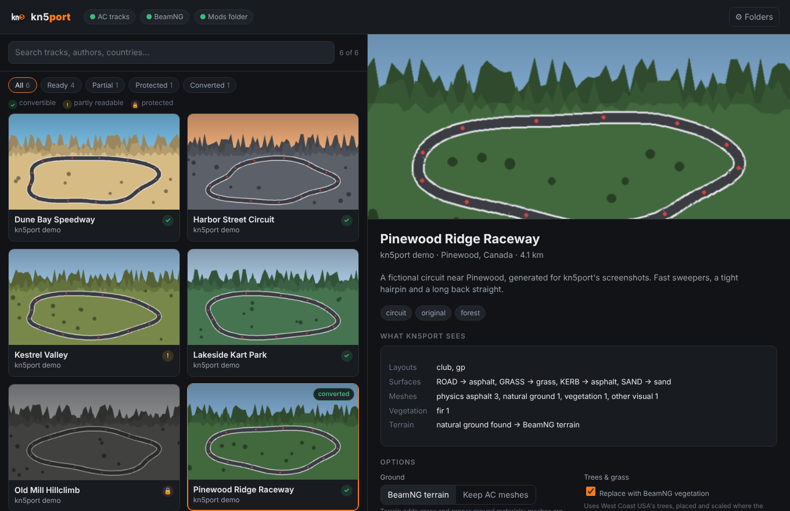</a><br><sub>Assetto Corsa</sub></td>
<td width="50%"><a href="#forza-horizon-1">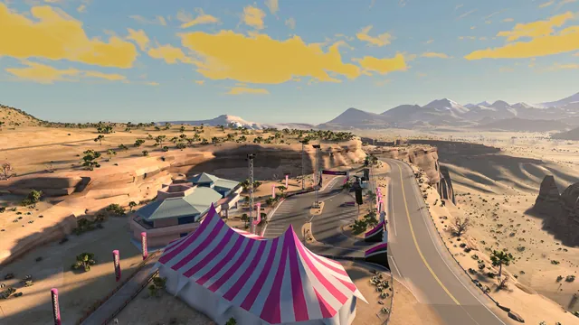</a><br><sub>Forza Horizon 1</sub></td>
</tr>
</table>

## Assetto Corsa

Pick a track in the app and convert it. kn5port writes the BeamNG level into your mods folder.

- **Every track in one place.** kn5port finds Assetto Corsa and BeamNG through Steam, lists your tracks with
  their previews, and marks each one as ready, partly readable or protected. It also shows which ones you've
  already converted.
- **A drivable BeamNG level.** Roads, kerbs and gravel keep their grip, so asphalt drives like asphalt and grass
  like grass. Buildings and props come across, and every pit and start position becomes a spawn point.
- **BeamNG scenery.** The ground becomes a real BeamNG terrain with 3D grass, and AC's flat tree cards become
  BeamNG trees, sized to match the track's own. You pick which stock map the trees and ground come from:
  West Coast USA, Italy, Utah, Jungle Rock Island and more.
- **Checked before you drive.** After converting, kn5port checks the level, including that every AI racing line
  has road under it.

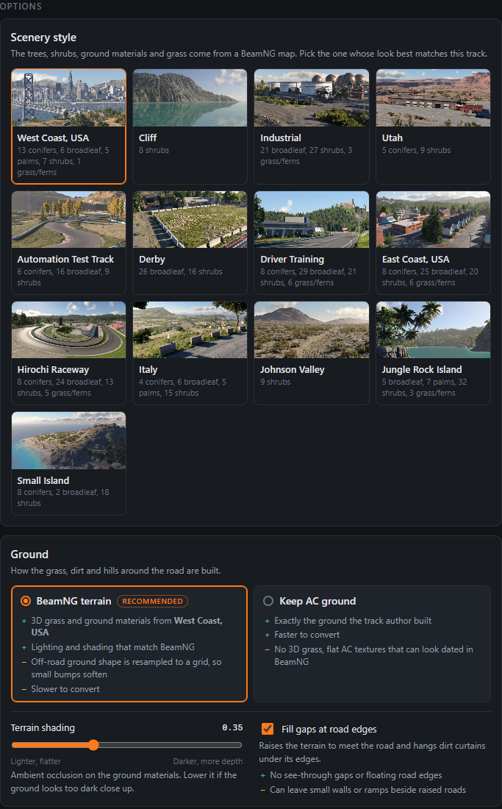


Magione (above) converts in under a minute; long roads take longer. **Fully restart BeamNG** afterwards (it caches materials), then
pick the track from the level list.

## Forza Horizon 1

The **Forza Horizon 1** tab turns Colorado from your own copy of Forza Horizon (2012, Xbox 360) into a BeamNG
level. You get the terrain, roads, buildings, plants, water, lights and ambient sound, with FH1's races as time
trials. FH1's three radio stations, DJs included, come as a separate mod that works on any map.


Point it at a Games on Demand folder, a disc image (`.iso`) or extracted files. Then build the whole 16 km
map (about 10 minutes, 3.3 GB) or a quick 4 km chunk around Red Rock or Clear Springs. The first time, the app
offers to download what it needs, about 100 MB. See [`fh1/`](fh1/README.md) for how it works.

<table>
<tr>
<td width="50%"><br><sub>Red Rock, morning to night</sub></td>
<td width="50%">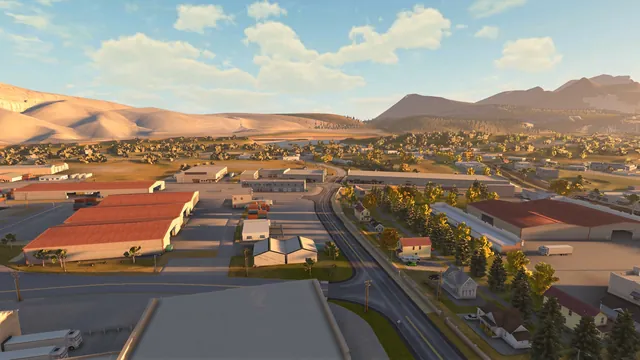<br><sub>Carson, morning to night</sub></td>
</tr>
<tr>
<td>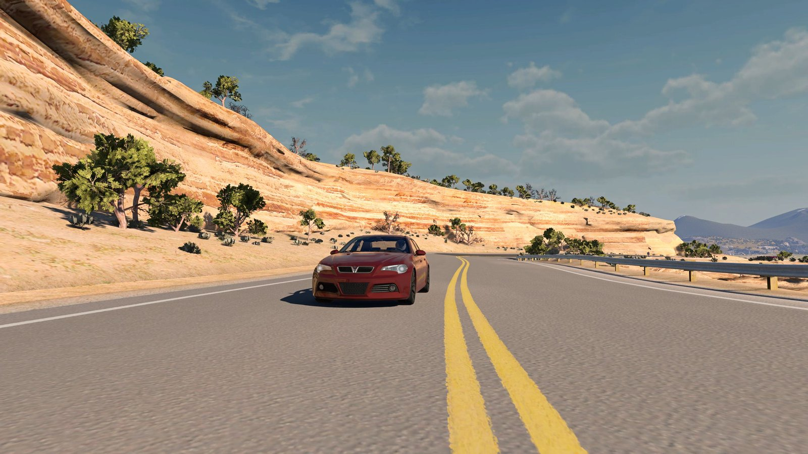<br><sub>Red Rock canyon road</sub></td>
<td>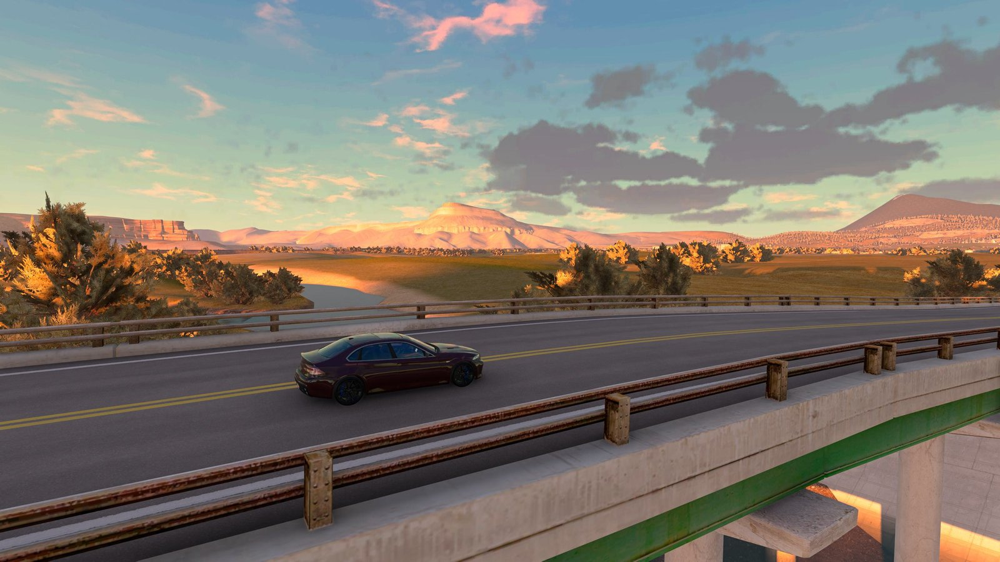<br><sub>Montano Plains</sub></td>
</tr>
<tr>
<td>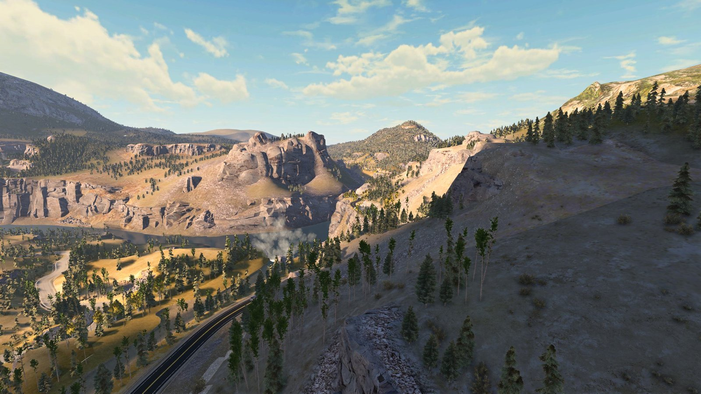<br><sub>The Rockies</sub></td>
<td>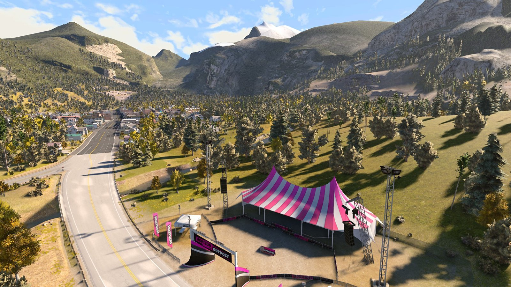<br><sub>South Beaumont</sub></td>
</tr>
<tr>
<td>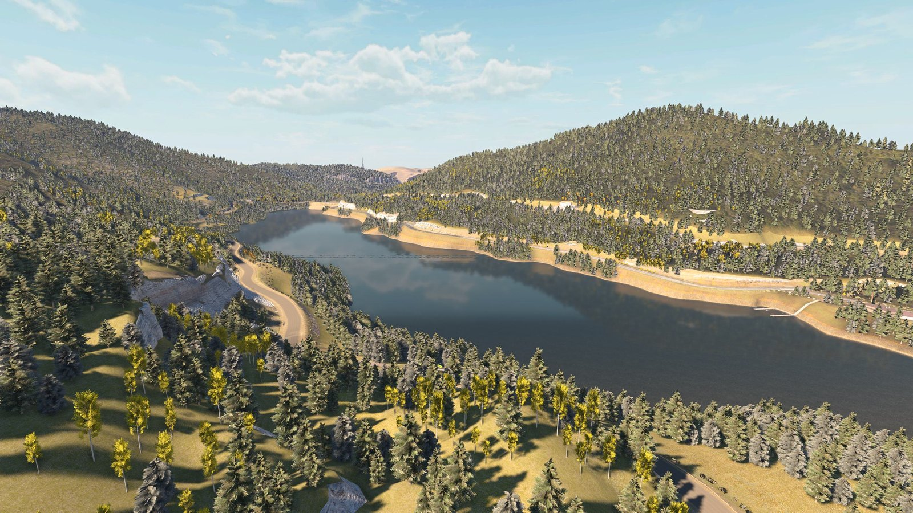<br><sub>Clear Springs</sub></td>
<td>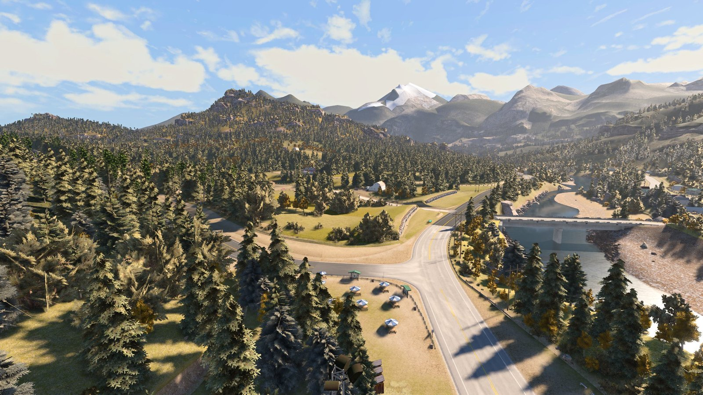<br><sub>Gladstone Estate</sub></td>
</tr>
<tr>
<td>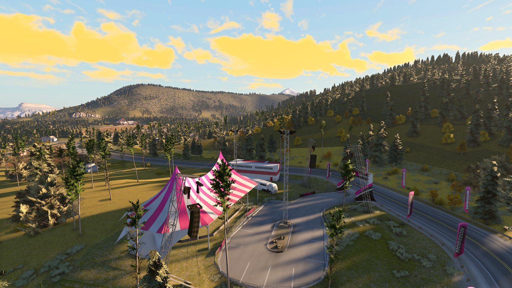<br><sub>Kettle Hills</sub></td>
<td>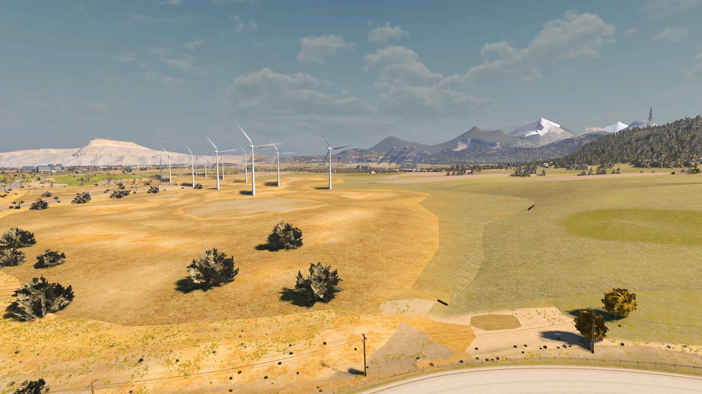<br><sub>Route 4</sub></td>
</tr>
<tr>
<td>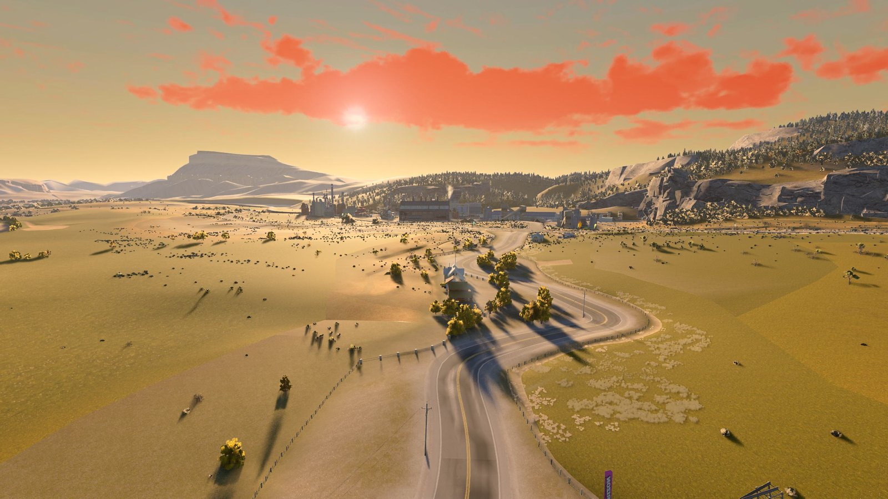<br><sub>Steelworks</sub></td>
<td>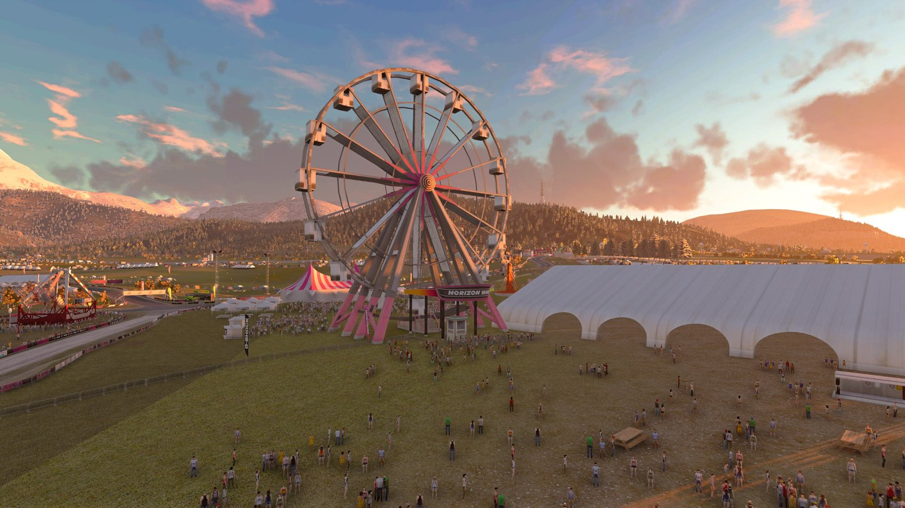<br><sub>Horizon Festival</sub></td>
</tr>
</table>

FH1's moving scenery comes across too: wind turbines, windmills, the festival's rides, farm machines, balloons and
the blimp.

<p align="center">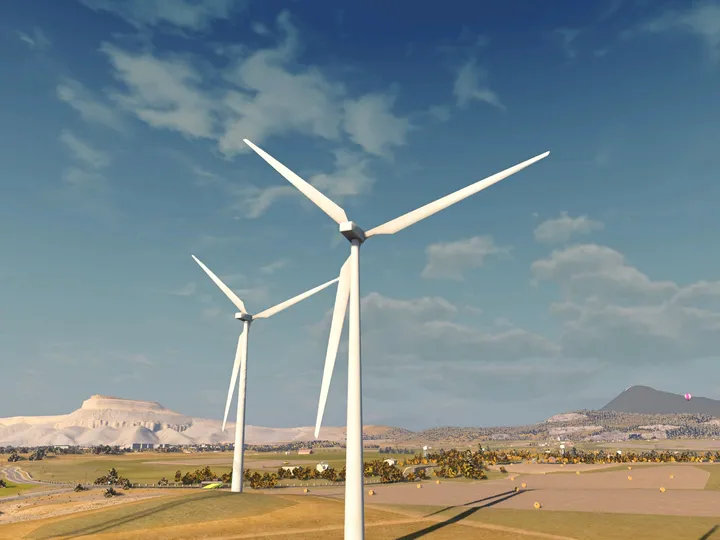</p>

## Install

Download `kn5port.exe` from [releases](../../releases) and run it. There's nothing to install.

##### From source (Python 3.9+):

```
git clone https://github.com/romangarms/kn5port
cd kn5port
pip install .
kn5port-app
```

## Command line

```
kn5port inspect  <AC track folder>     # what kn5port sees in a track
kn5port convert  <AC track folder>     # writes mods\unpacked\<track>
kn5port ui                             # the app, in your browser
```

`kn5port convert --help` lists every option: scenery style (`--palette italy`), tree density, keeping AC's ground
or trees, and more. If a track needs tweaks, put a `kn5port.json` next to it
([example](profiles/skyline_boulevard.json)).

## Known limits

- Big maps get coarser terrain, since BeamNG terrain tops out at 4096².
- AC's special shaders (CSP grass, reflections) don't exist in BeamNG, so materials are simpler.
- Trees and grass are BeamNG's own, so the species won't always match.
- No AI paths, race timing or night lighting for AC tracks yet.

## Personal use only

kn5port contains no game content. It reads files you already have and writes the level into your own mods
folder. Converted levels are derivative works, so don't share them, and check each track's license first.
Protected or encrypted tracks are skipped.

## More

- [How it works](docs/how-it-works.md) and [what broke along the way](docs/learnings.md)
- Build the exe: `packaging\build.ps1`. Release: `python packaging/release.py [patch|minor|major]` bumps the
  version, tags it and pushes; GitHub Actions then builds `kn5port.exe` and publishes it on the releases page.
- License: MIT for the code. It grants no rights to the tracks you convert or to BeamNG content.
