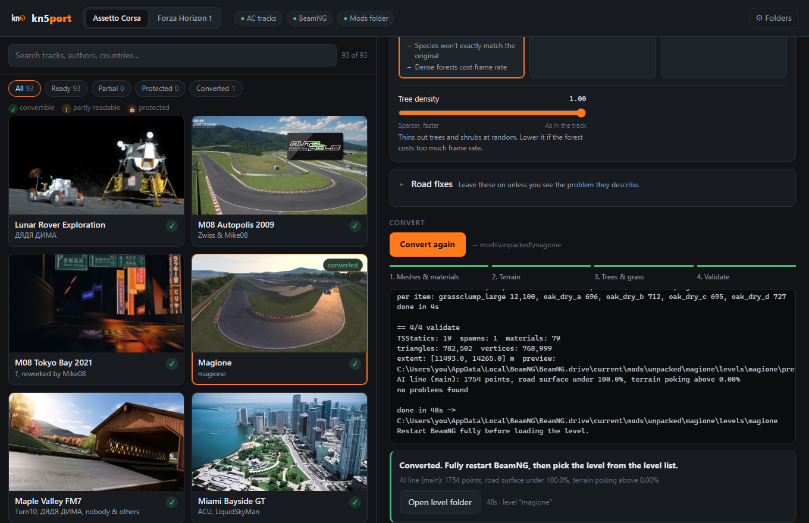
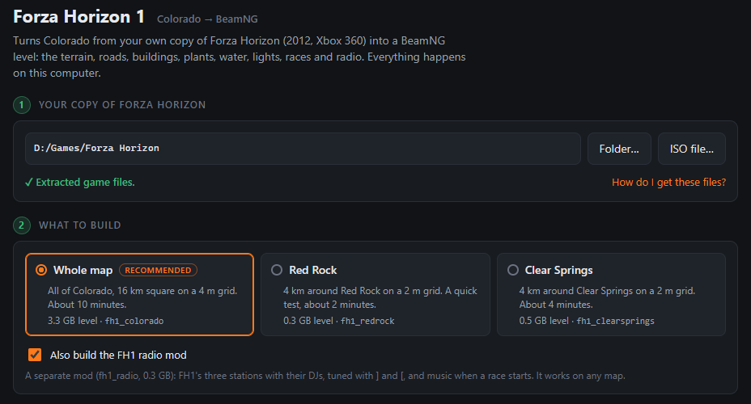

<p align="center"></p>

# kn5port

Turn the Assetto Corsa tracks you already have into BeamNG.drive levels with one click. It can also convert
Forza Horizon 1's Colorado map from your own copy of the game.


## What you get

- **Every track in one place.** kn5port finds Assetto Corsa and BeamNG through Steam, lists your tracks with
  their previews, and marks each one as ready, partly readable or protected. It also shows which ones you've
  already converted.
- **A drivable BeamNG level.** Roads, kerbs and gravel keep their grip, so asphalt drives like asphalt and grass
  like grass. Buildings and props come across, and every pit and start position becomes a spawn point.
- **BeamNG scenery.** The ground becomes a real BeamNG terrain with 3D grass, and AC's flat tree cards become
  BeamNG trees, sized to match the track's own. You pick which stock map the trees and ground come from:
  West Coast USA, Italy, Utah, Jungle Rock Island and more.
- **Checked before you drive.** After converting, kn5port checks the level, including that every AI racing line
  has road under it.




Magione (above) converts in under a minute; long roads take longer. **Fully restart BeamNG** afterwards (it caches materials), then
pick the track from the level list.

## Forza Horizon 1

The **Forza Horizon 1** tab turns Colorado from your own copy of Forza Horizon (2012, Xbox 360) into a BeamNG
level. You get the terrain, roads, buildings, plants, water, lights and ambient sound, with FH1's races as time
trials. FH1's three radio stations, DJs included, come as a separate mod that works on any map.



Point it at a Games on Demand folder, a disc image (`.iso`) or extracted files. Then build the whole 16 km
map (about 10 minutes, 3.3 GB) or a quick 4 km chunk around Red Rock or Clear Springs. The first time, the app
offers to download what it needs, about 100 MB. See [`fh1/`](fh1/README.md) for how it works.

## Install

Download `kn5port.exe` from [releases](../../releases) and run it. There's nothing to install.

From source (Python 3.9+): `pip install .[app]` (or `.[app,fh1]` for Forza Horizon), then run `kn5port-app`.

## Command line

```
kn5port inspect  <AC track folder>     # what kn5port sees in a track
kn5port convert  <AC track folder>     # writes mods\unpacked\<track>
kn5port ui                             # the app, in your browser
```

`kn5port convert --help` lists every option: scenery style (`--palette italy`), tree density, keeping AC's ground
or trees, and more. If a track needs tweaks, put a `kn5port.json` next to it
([example](profiles/skyline_boulevard.json)).

## Known limits

- Big maps get coarser terrain, since BeamNG terrain tops out at 4096².
- AC's special shaders (CSP grass, reflections) don't exist in BeamNG, so materials are simpler.
- Trees and grass are BeamNG's own, so the species won't always match.
- No AI paths, race timing or night lighting for AC tracks yet.

## Personal use only

kn5port contains no game content. It reads files you already have and writes the level into your own mods
folder. Converted levels are derivative works, so don't share them, and check each track's license first.
Protected or encrypted tracks are skipped.

## More

- [How it works](docs/how-it-works.md) and [what broke along the way](docs/learnings.md)
- Build the exe: `packaging\build.ps1`. Tagging `v*` publishes a release through GitHub Actions.
- License: MIT for the code. It grants no rights to the tracks you convert or to BeamNG content.
